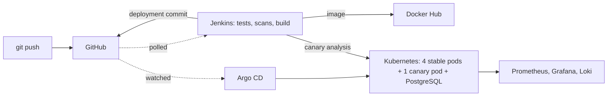

# EventHub - End-to-End DevOps Automation Platform

**Capstone project, DevOps and Automation Lab (ENSP461), K.R. Mangalam University**  
**Student:** Aditya Porwal (Roll No. 2301010345) | **GitHub:** `Adityaporwal18` | **Docker Hub:** `adityaporwal18`

EventHub is a campus event registration application. This repository contains the application and the platform that delivers it: a push to `main` is tested, scanned, built, released to one of five pods as a canary, checked, and then promoted or rolled back automatically.

| Document | Contents |
|---|---|
| [Capstone report](REPORT.md) | Problem, architecture, implementation, testing, results, conclusions |
| [Capstone report (PDF)](docs/Capstone_Report_Aditya_Porwal_2301010345.pdf) | The same report with all screenshots, for submission |
| [Evidence gallery](docs/EVIDENCE.md) | Every screenshot with a caption and links to the logs |
| [Commands executed](commands.txt) | The commands that were run, in the order of the report |
| [Logs](docs/evidence/logs) and [sample application logs](docs/samples) | Terminal logs, Jenkins console logs, scan reports |

## Platform



| Area | Tools |
|---|---|
| Application | Python, Flask, Gunicorn, PostgreSQL |
| Version control | Git, GitHub |
| CI/CD | Jenkins (declarative pipeline) |
| Containers | Docker, Docker Compose, Docker Hub |
| Orchestration | Kubernetes (Minikube), Argo CD |
| Infrastructure automation | Ansible, Terraform |
| Monitoring and logging | Prometheus, Grafana, Loki, Promtail |
| Security | Bandit, pip-audit, Trivy |
| Deployment strategy | Canary with automatic analysis and rollback |

## Results of the recorded run (27 November 2026)

| Build | What was pushed | Outcome |
|---|---|---|
| #1 | Pipeline added (release 0.1.0) | Promoted after a clean canary |
| #2 | Release 0.2.0 (statistics feature) | Promoted 1 min 57 s after the push |
| #3 | A commit with a bug | Stopped by a failing unit test; nothing deployed |
| #4 | Release 0.3.0 with a fault | Canary failed 52.8% of its requests; rolled back automatically after 27 s |
| #5 | Release 0.3.1 (fault removed) | Promoted |
| #6 | Operations commits, unchanged application | Promoted |

Recovery drill: a deleted pod was replaced in 7.3 s, a manual change was undone by Argo CD in about 21 s, and deleted data was restored from a backup in 4.6 s with an identical checksum.

## Execution steps

The steps assume an Ubuntu 24.04 machine (or VM) with at least 4 CPUs and 5 GiB of memory.

### 1. Tools

Install Docker Engine with the Compose plugin, kubectl, Minikube, Ansible, Terraform, Jenkins (with Java 21) and Trivy. The exact commands used are in [commands.txt](commands.txt) and in the Lab 1 to Lab 3 repositories.

### 2. Run the application locally

```bash
git clone https://github.com/Adityaporwal18/devops-capstone.git
cd devops-capstone
printf 'POSTGRES_PASSWORD=%s\nAPP_VERSION=0.3.1\n' "$(openssl rand -hex 16)" > .env
docker compose up -d --build
curl http://localhost:8000/health/ready
```

Open http://localhost:8000. Stop it with `docker compose down`.

### 3. Run the tests

```bash
scripts/test.sh
```

### 4. Build the platform

```bash
ansible-playbook -i infrastructure/ansible/inventory.ini infrastructure/ansible/bootstrap.yml
terraform -chdir=infrastructure/terraform init
terraform -chdir=infrastructure/terraform apply
kubectl apply -f infrastructure/argocd/application.yaml -f infrastructure/argocd/platform.yaml
kubectl get applications -n argocd
```

Ansible starts the Minikube profile `capstone` and installs Argo CD. Terraform creates the namespaces, quota and Secrets. Argo CD then deploys the application and the monitoring stack from this repository.

To use your own fork, change the repository URL in `infrastructure/argocd/*.yaml`, `scripts/gitops.sh` and `jenkins/job-config.xml`, and the image name in `Jenkinsfile`, `scripts/gitops.sh` and `deploy/k8s/app-*.yaml`.

### 5. Open the services

```bash
kubectl port-forward -n eventhub service/eventhub 8088:8000 &
kubectl port-forward -n monitoring service/grafana 3000:3000 &
kubectl port-forward -n monitoring service/prometheus 9090:9090 &
kubectl port-forward -n argocd service/argocd-server 8443:443 &
```

| Service | Address |
|---|---|
| EventHub | http://localhost:8088 |
| Grafana dashboard (anonymous viewer) | http://localhost:3000/d/eventhub |
| Prometheus | http://localhost:9090 |
| Argo CD | https://localhost:8443 (user `admin`; password in the Secret `argocd-initial-admin-secret`) |
| Jenkins | http://localhost:8080 |

### 6. Set up the pipeline

1. Let the `jenkins` user use Docker and kubectl: add it to the `docker` group, log it in to Docker Hub (`sudo -u jenkins docker login`), and allow it to run `kubectl` as the user that owns the kubeconfig (a sudo rule, see `commands.txt`).
2. Create an SSH key pair, add the public key to the GitHub repository as a deploy key with write access, and store the private key in Jenkins as the credential `eventhub-gitops-key` (type: SSH username with private key).
3. Create the job from `jenkins/job-config.xml` and start the first build.

After that, every push to `main` that changes the application runs the pipeline.

### 7. Release and recover

```bash
# release: change the code, then
git commit -am "..." && git push            # Jenkins does the rest

# recovery
scripts/backup-now.sh                        # extra database backup
scripts/restore-db.sh                        # restore the newest backup
scripts/db-fingerprint.sh                    # row counts and checksum
```

## Repository layout

```text
app/                      Flask application (rules, database access, telemetry, routes, dashboard)
tests/                    Unit tests and integration tests
Dockerfile                Multi-stage image: base, test, runtime
docker-compose.yml        Local stack: application + PostgreSQL
compose.test.yml          Throwaway PostgreSQL for the integration tests
release.env               Version of the next release (and the fault switch used for testing)
Jenkinsfile               Pipeline definition
jenkins/job-config.xml    Jenkins job definition
scripts/                  Test runner, GitOps commits, rollout wait, canary analysis, backup, restore
infrastructure/ansible/   Cluster and Argo CD bootstrap
infrastructure/terraform/ Namespaces, quota, limits, Secrets
infrastructure/argocd/    Argo CD applications
deploy/k8s/               Application manifests (stable, canary, Service, PostgreSQL, backup)
deploy/platform/          Prometheus, Grafana, Loki, Promtail and their configuration
deploy/recovery/          Restore pod used by scripts/restore-db.sh
docs/                     Report PDF, evidence gallery, screenshots, logs, samples, recovery targets
```

## Scope

This is a working model on one virtual machine with a single-node cluster. It is not a production installation; the report lists the limits.
