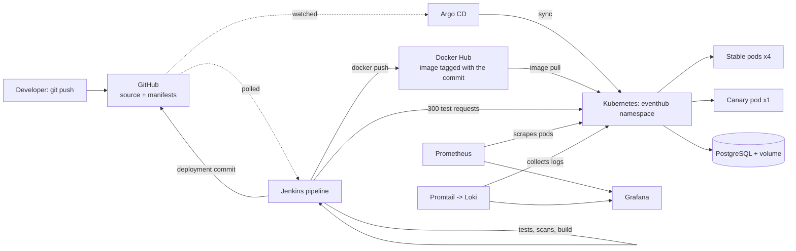
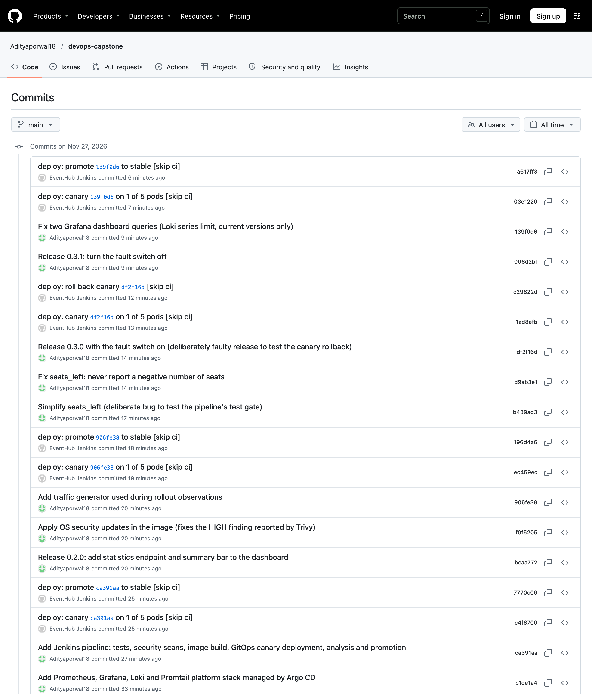
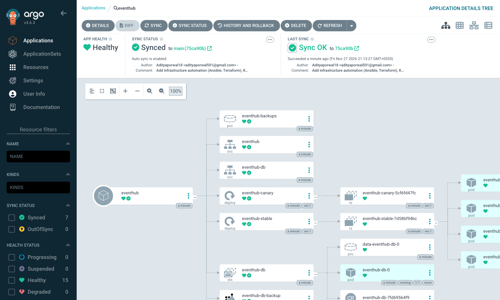
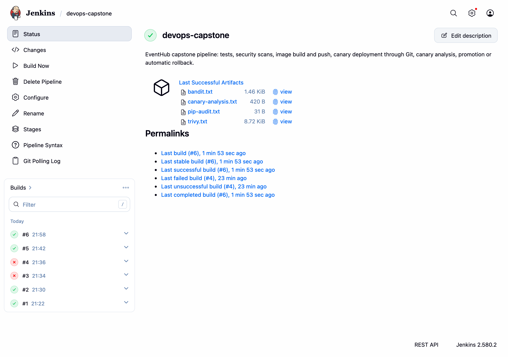
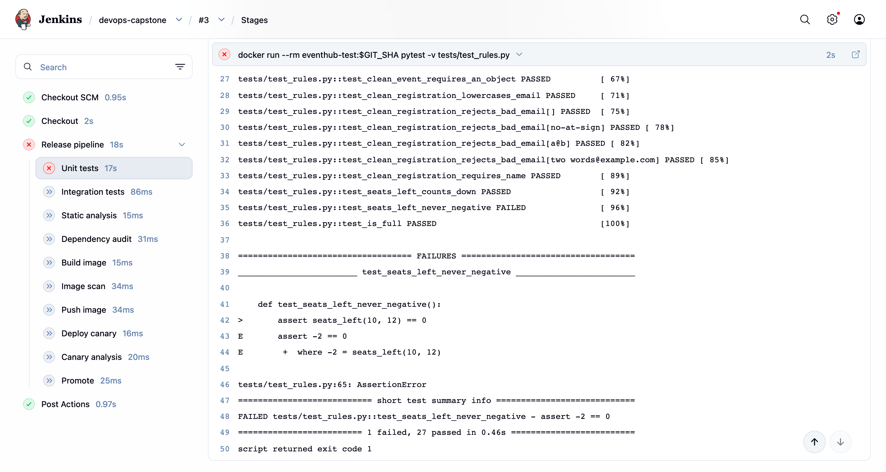
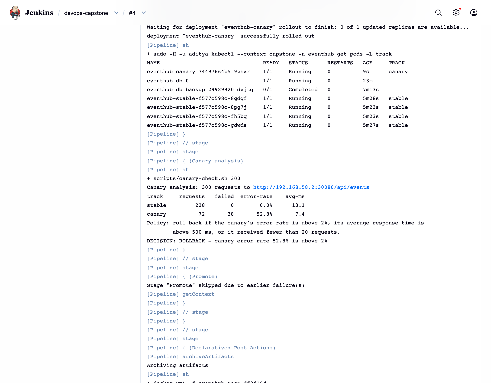
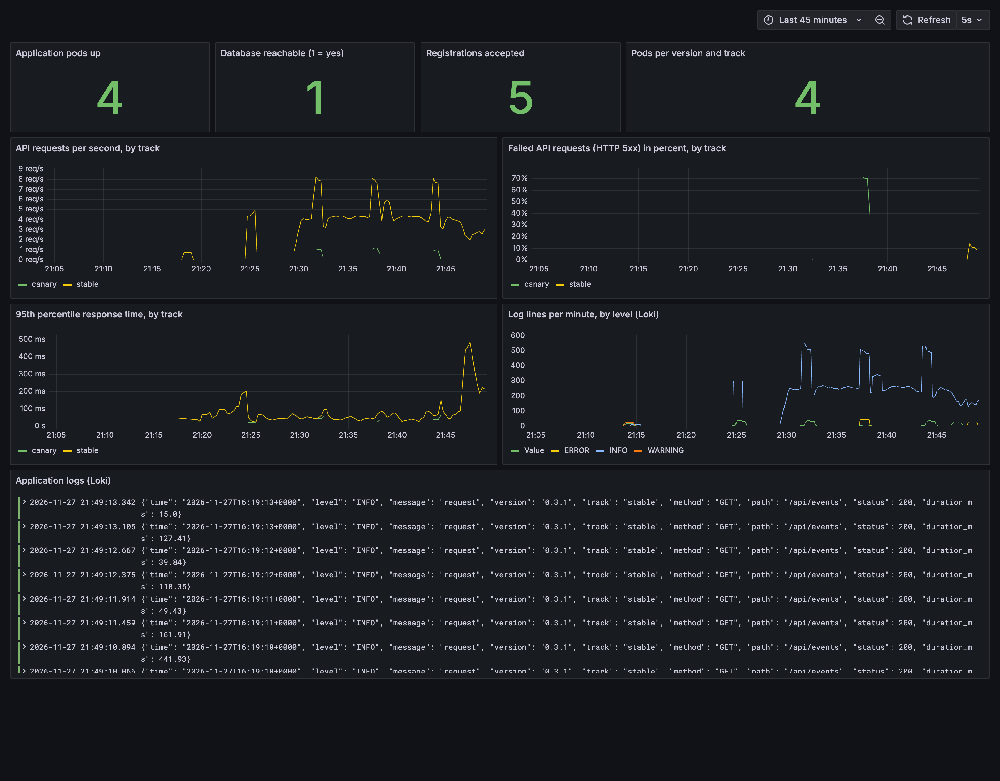
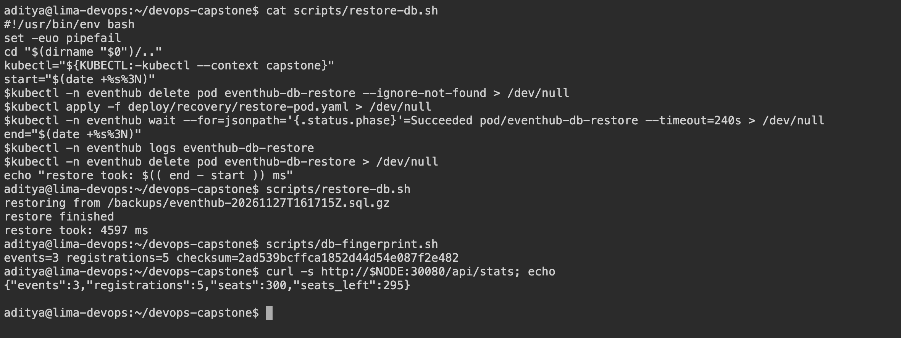

# EventHub - End-to-End DevOps Automation Platform

**Capstone project, DevOps and Automation Lab (ENSP461)**  
**Student:** Aditya Porwal (Roll No. 2301010345)  
**University:** K.R. Mangalam University  
**Instructor:** Sourabh Jain | **Coordinator:** Amit Kumar Singh  
**Repository:** https://github.com/Adityaporwal18/devops-capstone  
**Container images:** https://hub.docker.com/r/adityaporwal18/eventhub  
**Environment:** Ubuntu 24.04.5 LTS virtual machine (Lima 2.3.0, 4 CPUs, 5 GiB RAM) on a MacBook Pro (Apple M1)  
**Date of the recorded run:** 27 November 2026

[Repository overview and execution steps](README.md) | [Evidence gallery](docs/EVIDENCE.md) | [Commands executed](commands.txt)

## 1. Problem statement

Releasing software by hand is slow and risky. Someone has to run the tests, build and upload a package, change the servers, watch for problems and undo the change if something breaks. Each manual step can be forgotten or done differently the next time.

This capstone builds one platform that automates that whole path for a chosen application, **EventHub**, a campus event registration system. A developer only pushes a commit. The platform tests it, scans it, packages it, releases it to a small share of traffic, checks how it behaves, and then either promotes it or removes it, without anyone logging in to a server. The platform also has to show what is happening (monitoring and logging), keep credentials safe (security) and be able to recover from failures (recoverability).

| Requirement of the capstone brief | How it is met | Report section |
|---|---|---|
| Version control | Git and GitHub; every change, including each deployment, is a commit | 3 |
| CI/CD pipeline | Jenkins pipeline with 11 stages, started by a push | 7, 8 |
| Containerization | Multi-stage Dockerfile, Docker Compose, images on Docker Hub | 4 |
| Kubernetes orchestration | Minikube cluster: Deployments, StatefulSet, Services, CronJob, quota | 6 |
| Infrastructure automation | Ansible builds the cluster; Terraform creates namespaces, quota and Secrets | 5 |
| Monitoring | Prometheus with alert rules, Grafana dashboard | 10 |
| Logging | JSON application logs collected by Promtail into Loki, viewed in Grafana | 10 |
| Security | Three scanners with gates, hardened containers, credentials outside Git | 11 |
| Advanced deployment strategy | Canary release with automatic analysis and automatic rollback | 9 |
| Recoverability | Database backup and restore, self-healing pods, drift repair, release rollback | 12 |
| Reproducible workflow | One playbook, one Terraform apply and two manifests rebuild the platform | 16 |

**Scope.** The platform runs on a single-node Kubernetes cluster inside one virtual machine. "Production" in this report means the stable Deployment of that cluster. Section 14 lists what a real production setup would add.

## 2. Design and architecture



**How a change reaches production.**

1. A developer pushes a commit to `main` on GitHub.
2. Jenkins polls GitHub, finds the commit and starts the pipeline.
3. The pipeline runs the unit tests, the integration tests against a real database, a static code scan and a dependency audit. Any failure stops it.
4. It builds the image, scans it and pushes it to Docker Hub, tagged with the Git commit.
5. It commits a change to the canary manifest in Git: the new image, on 1 pod. Argo CD applies it, so 1 of 5 pods runs the new version.
6. It sends 300 requests through the Service and compares the canary's results with a written policy.
7. If the canary passes, the pipeline commits the new image to the stable manifest and Argo CD rolls it out. If it fails, the pipeline commits the canary back to 0 pods.

Nothing is changed in the cluster by hand or by Jenkins directly. Jenkins only changes Git; Argo CD makes the cluster match Git. Git therefore holds the full history of what was deployed and when.

| Component | Version | Role |
|---|---|---|
| EventHub application | 0.1.0 to 0.3.1 | Flask application with PostgreSQL |
| Git / GitHub | 2.43.0 | Source and deployment history |
| Jenkins | 2.580.2 | CI/CD pipeline |
| Docker / Compose | 29.10.1 / v5.8.0 | Image build, local stack, test containers |
| Docker Hub | - | Image registry |
| Minikube / Kubernetes | v1.39.0 / v1.37.0 | Cluster |
| Argo CD | v3.6.3 | GitOps delivery |
| Ansible | core 2.16.3 | Cluster bootstrap |
| Terraform | 1.17.2 (kubernetes provider 2.38.0, random 3.9.1) | Namespaces, quota, Secrets |
| Prometheus / Grafana | v3.0.0 / 11.3.0 | Metrics, alerts, dashboard |
| Loki / Promtail | 3.2.1 | Log storage and collection |
| Bandit / pip-audit / Trivy | 1.9.4 / 2.10.1 / 0.76.2 | Security scans |

## 3. Application and version control

**Application.** EventHub lets a user add events with a venue, date and number of seats, and register people for them. It refuses a second registration with the same email and refuses registrations when an event is full. The code is in [app](app): validation rules without database access ([rules.py](app/rules.py)), database access ([db.py](app/db.py)), metrics and logging ([telemetry.py](app/telemetry.py)) and the routes ([__init__.py](app/__init__.py)).

| Endpoint | Purpose |
|---|---|
| `GET /` | Dashboard page |
| `GET, POST /api/events`, `DELETE /api/events/<id>` | List, create and delete events |
| `GET, POST /api/events/<id>/registrations` | List people and register for an event |
| `GET /api/stats` | Totals (added in release 0.2.0) |
| `GET /api/version` | Version, Git commit and track of the instance that answered |
| `GET /health/live`, `GET /health/ready` | Liveness; readiness including a database check |
| `GET /metrics` | Prometheus metrics |

Every response carries the headers `X-EventHub-Track` and `X-EventHub-Version`, so a test can tell which version answered. The application also has a fault switch for testing: with `FAULT_RATE` set, that share of API requests returns HTTP 500. It is 0 in normal releases.

**Version control.** The repository was built up in small commits with descriptive messages. Two authors appear in the history: `Adityaporwal18` for source changes and `EventHub Jenkins` for the deployment commits that the pipeline makes. After build #6 the history had 26 commits, 10 of them made by the pipeline.



## 4. Containerization

The [Dockerfile](Dockerfile) has three stages. `base` installs the runtime dependencies and the application. `test` adds the test tools and the tests; the pipeline runs tests and code scans inside it. `runtime` is the image that is deployed: it runs Gunicorn as user 10001 and contains no test tools.

[docker-compose.yml](docker-compose.yml) runs the application with PostgreSQL for local use. [compose.test.yml](compose.test.yml) starts a throwaway PostgreSQL for the integration tests.

| Check | Result |
|---|---|
| Image built and started with Compose | `eventhub:0.1.0`, application and database healthy |
| API | Registration accepted, duplicate rejected, metrics and JSON logs present |
| User inside the container | `uid=10001`, not root |
| Root filesystem | Read-only (`touch` fails) |
| Linux capabilities | All dropped, `no-new-privileges` set |
| Registry | `adityaporwal18/eventhub:0.1.0` pushed by hand once; every later image pushed by the pipeline |

## 5. Infrastructure automation

**Ansible** ([bootstrap.yml](infrastructure/ansible/bootstrap.yml)) prepares the platform cluster: it checks that the tools are installed, starts a dedicated Minikube profile, installs Argo CD at a pinned version, turns off the three Argo CD components this platform does not use, and waits until everything is ready.

**Terraform** ([infrastructure/terraform](infrastructure/terraform)) creates what the application needs inside the cluster: the `eventhub` and `monitoring` namespaces, a resource quota and default limits, and the database and Grafana Secrets with randomly generated passwords.

| Run | Result |
|---|---|
| Ansible, first run | `ok=11 changed=4 failed=0`: cluster started, Argo CD installed |
| Ansible, second run | `ok=7 changed=0 skipped=4`: nothing to change (idempotent) |
| `terraform plan` / `apply` | 6 resources added |
| `terraform plan` again | No differences |
| Later change (Grafana Secret) | 2 resources added, 8 in total |

The passwords exist only in the cluster and in Terraform's local state file, which is not committed.

## 6. Kubernetes orchestration and GitOps

The manifests in [deploy/k8s](deploy/k8s) are applied by the Argo CD application [eventhub](infrastructure/argocd/application.yaml); those in [deploy/platform](deploy/platform) by the application [eventhub-platform](infrastructure/argocd/platform.yaml). Both use automated sync with pruning and self-healing.

| Resource | Purpose |
|---|---|
| Deployment `eventhub-stable` (4 replicas) | The version that serves users |
| Deployment `eventhub-canary` (0 or 1 replica) | The version under test |
| Service `eventhub` (NodePort 30080) | Selects the pods of both Deployments, so traffic is shared by pod count |
| StatefulSet `eventhub-db` with a 1 Gi volume | PostgreSQL |
| CronJob `eventhub-db-backup` with a 1 Gi volume | Database backup every 30 minutes |
| Resource quota and limit range | At most 20 pods; default requests and limits |

Each application pod has a readiness probe that includes the database and a liveness probe, runs as a non-root user with a read-only root filesystem, and declares resource requests and limits.



## 7. CI/CD pipeline

The pipeline is defined in the [Jenkinsfile](Jenkinsfile). The Jenkins job ([job-config.xml](jenkins/job-config.xml)) reads it from GitHub and polls for changes every two minutes.

| Stage | What it does | Stops the release when |
|---|---|---|
| Checkout | Fetches the commit, reads the version from `release.env` | - |
| Unit tests | Runs the rule tests in the test image | A test fails |
| Integration tests | Runs the API tests against a PostgreSQL container | A test fails |
| Static analysis | Bandit scans the Python code | A High severity finding |
| Dependency audit | pip-audit checks the dependencies | Any known vulnerability |
| Build image | Builds the runtime image tagged with the commit | The build fails |
| Image scan | Trivy scans the image | A Critical finding that has a fix |
| Push image | Pushes to Docker Hub | The push fails |
| Deploy canary | Commits the canary manifest; waits for Argo CD and the rollout | The rollout fails |
| Canary analysis | 300 requests, compared with the canary policy | The policy is breached |
| Promote | Commits the stable manifest; waits for the rollout | The rollout fails |

If the pipeline fails after the canary was deployed, a post action rolls the canary back. Polling ignores the pipeline's own deployment commits (message contains `[skip ci]`) and commits that touch only documentation or operations files.

**Recorded runs.**

| Build | Started | Trigger | Commit | Release | Result | Duration |
|---|---|---|---|---|---|---|
| #1 | 21:22:43 | Manual, user Aditya Porwal | `ca391aa` | 0.1.0 | SUCCESS - promoted | 143 s |
| #2 | 21:30:09 | SCM change | `906fe38` | 0.2.0 | SUCCESS - promoted | 114 s |
| #3 | 21:34:09 | SCM change | `b439ad3` | 0.2.0 with a bug | FAILURE - stopped at Unit tests | 26 s |
| #4 | 21:36:09 | SCM change | `df2f16d` | 0.3.0, faulty | FAILURE - canary rolled back | 84 s |
| #5 | 21:42:09 | SCM change | `139f0d6` | 0.3.1 | SUCCESS - promoted | 119 s |
| #6 | 21:58:09 | SCM change | `686d534` | 0.3.1, unchanged code | SUCCESS - promoted | 107 s |

Build #6 was started by two operations commits before the path filter took effect; it rebuilt the unchanged application and took it through the same process.

**Time from push to production.** Release 0.2.0 was pushed at 21:29:49 and Argo CD finished the promotion at 21:31:46, 1 minute 57 seconds later. Release 0.3.1 took 3 minutes 2 seconds (pushed 21:40:46, promoted 21:43:48); the difference is the wait for the next poll.



## 8. Automated testing as a pipeline gate

| Suite | Tests | What it covers |
|---|---|---|
| Unit ([test_rules.py](tests/test_rules.py)) | 28 | Validation of events and registrations, seat arithmetic; no database |
| Integration ([test_api.py](tests/test_api.py)) | 13, then 15 from release 0.2.0 | The HTTP API with a real PostgreSQL: create, register, duplicate, full event, delete, health, metrics, statistics |

Both suites run in containers, so the pipeline needs no Python installation on the Jenkins machine and the tests run in the same image layers that are deployed.

**Gate demonstration.** A commit changed `seats_left` so that it could return a negative number. In build #3 the test `test_seats_left_never_negative` failed (`assert -2 == 0`; 1 failed, 27 passed). Jenkins skipped the nine remaining stages, no image was built, and the cluster kept running release 0.2.0.



**Limit.** The integration tests call the application in-process through Flask's test client. Requests over the network are first made in the canary analysis.

## 9. Canary deployment and automatic rollback

**Mechanism.** The stable Deployment has 4 pods. A release starts as 1 canary pod behind the same Service, so it receives about 1 in 5 requests (20%). [canary-check.sh](scripts/canary-check.sh) sends 300 requests and uses the track header of each response to count requests, failures and response time per track.

**Policy.** The canary is rolled back if its error rate is above 2%, if its average response time is above 500 ms, or if it received fewer than 20 requests.

| Build | Release | Canary requests | Canary failures | Stable requests | Stable failures | Decision |
|---|---|---|---|---|---|---|
| #1 | 0.1.0 | 61 | 0 | 239 | 0 | PROMOTE |
| #2 | 0.2.0 | 60 | 0 | 240 | 0 | PROMOTE |
| #4 | 0.3.0, faulty | 72 | 38 (52.8%) | 228 | 0 | ROLLBACK |
| #5 | 0.3.1 | 50 | 0 | 250 | 0 | PROMOTE |
| #6 | 0.3.1 | 72 | 0 | 228 | 0 | PROMOTE |

**The faulty release.** Release 0.3.0 was built with `FAULT_RATE=0.5`. It passed all 43 tests and all scans, because the fault only shows under real requests. In the cluster 38 of its 72 requests failed. The pipeline decided ROLLBACK, committed the canary back to 0 pods and Argo CD applied it.

| Time | Event |
|---|---|
| 21:35:22 | Release 0.3.0 pushed |
| 21:36:57 | Pipeline commits the canary; Argo CD syncs it at 21:37:04 |
| 21:37:24 | Pipeline commits the rollback; Argo CD syncs it at 21:37:31 |

The faulty version served traffic for about 27 seconds, on one of five pods. Afterwards 100 of 100 test requests were answered by the stable track, version 0.2.0, with HTTP 200.



**Limits.**

- The fault was produced with the application's fault switch, not by a real defect.
- The canary's share is a share of requests. The same user can reach either version on different requests.
- The analysis uses test requests sent by the pipeline and lasts a few seconds. It would not catch a problem that appears only after longer use.
- The background traffic of real users also reached the faulty canary: Prometheus counted 50 failed canary requests in total.

## 10. Monitoring and logging

**Metrics.** The application exports a request counter (method, route, status), a response-time histogram, a registration counter, a database gauge and build information. Prometheus finds the application pods through the Kubernetes API and adds each pod's `track` label, so every metric can be split into stable and canary. Three alert rules are defined in [alerts.yml](deploy/platform/config/alerts.yml): high error rate per track, instance down and database down.

**Logs.** The application writes one JSON line per request and per business event. Promtail reads the pod log files on the node and sends them to Loki with the labels namespace, pod, app and track.

**Dashboard.** Grafana's data sources and the dashboard are provisioned from files in [deploy/platform/config](deploy/platform/config), so the dashboard is rebuilt with the platform.



| Observation over 40 minutes | Value |
|---|---|
| Stable track, `/api/events` | 5,520 HTTP 200 and 17 HTTP 503 |
| Canary track, `/api/events` | 177 HTTP 200 and 50 HTTP 500 |
| Alert `EventHubHighErrorRate`, canary | Pending, then firing, during build #4 |
| Alert `EventHubHighErrorRate`, stable | Pending, then firing, during the recovery drill |
| Loki, ERROR lines | 45 from the canary, 27 from stable |

The 17 HTTP 503 responses and the stable alert come from the recovery drill in section 12: while the database was emptied, restored and restarted, the application answered some requests with "database unavailable". The monitoring recorded that outage without being told about the drill.

**A problem that occurred.** The first version of the dashboard had a Loki panel that showed an error. Its query parsed every JSON field of every log line, which created more series than Loki allows in one query. Parsing only the `level` field fixed it. The fix was released through the pipeline with build #5.

## 11. Security

| Area | Control | Evidence |
|---|---|---|
| Code | Bandit in the pipeline; the build fails on High severity | 0 High, 1 Medium, 1 Low |
| Dependencies | pip-audit in the pipeline; the build fails on any known vulnerability | No known vulnerabilities |
| Image | Trivy in the pipeline; the build fails on fixable Critical findings | 1 High in build #1, 0 from build #2 |
| Container | Non-root user, read-only root filesystem, no capabilities, seccomp default profile | Section 4 |
| Database password | Generated by Terraform, stored only as a Kubernetes Secret | Section 5 |
| Git access for the pipeline | Deploy key limited to this repository, stored in the Jenkins credential store | `eventhub-gitops-key` |
| Secrets in Git | None; `.env` and Terraform state are ignored | `.gitignore` |

**Findings and what was done.**

| Finding | Severity | Action |
|---|---|---|
| Trivy: `libzstd1`, CVE-2026-124851, in the base image | High | Fixed in release 0.2.0 by applying OS updates in the Dockerfile; build #2 reports 0 findings |
| Bandit B108: `/dev/shm` used as Gunicorn's worker directory | Medium | Accepted: it is needed because the root filesystem is read-only |
| Bandit B311: `random` used for the fault switch | Low | Accepted: not used for security |

**Limits.** The Docker Hub login used by Jenkins is a login session of the Jenkins account, not an entry in the credential store. Jenkins runs `kubectl` through a sudo rule as the user that owns the cluster configuration. Kubernetes Secrets are base64-encoded, not encrypted, in this cluster. The application has no user login.

## 12. Recoverability

The targets in [docs/recovery-targets.md](docs/recovery-targets.md) were written before the drill.

| Scenario | Target | Measured | Met |
|---|---|---|---|
| Application pod deleted | Ready within 60 s | 4 of 4 pods Ready after 7.3 s | Yes |
| Manual change to the cluster (scaled to 1) | Corrected within 60 s | Argo CD restored 4 pods in about 21 s | Yes |
| Data deleted from the database | Restored within 5 minutes | Restore took 4.6 s; same checksum as before | Yes |
| Data loss window (RPO) | At most 30 minutes | Backup job runs every 30 minutes; the drill used a backup taken just before | Yes |
| Database pod deleted | - | Ready after 11.7 s; data unchanged on the volume | - |
| Faulty release | Canary removed within 2 minutes | Rolled back 27 s after it was deployed | Yes |

**Backup and restore.** A CronJob dumps the database to a separate volume every 30 minutes and keeps the last 10 files. For the drill, five registrations were added and a backup was taken. [db-fingerprint.sh](scripts/db-fingerprint.sh) reported 3 events, 5 registrations and a checksum over all rows. The tables were then emptied. [restore-db.sh](scripts/restore-db.sh) restored the newest backup in 4,597 ms, and the fingerprint was identical.



**Limits.** The backups are on a volume in the same single-node cluster, so they protect against deleted data but not against losing the machine. Restoring replaces the tables while the application is running. While the database was being restored and its pod restarted (11.7 s), the application answered 17 requests with HTTP 503; there is one database instance and no standby.

## 13. Testing summary and results

| Test | Method | Result |
|---|---|---|
| Unit tests | 28 pytest cases in a container | All pass |
| Integration tests | 15 pytest cases against PostgreSQL | All pass |
| Container hardening | Commands inside the running container | Non-root, read-only, no capabilities |
| Infrastructure idempotency | Second Ansible run; second Terraform plan | No changes |
| Pipeline, normal release | Builds #1, #2, #5, #6 | Promoted automatically |
| Pipeline, test gate | Build #3 with a failing unit test | Stopped; nothing deployed |
| Pipeline, canary rollback | Build #4 with a faulty release | Rolled back automatically in 27 s |
| Traffic split | Requests counted per track | 50 to 72 of 300 to the canary (17% to 24%; expected 20%) |
| Monitoring | Prometheus targets, dashboard, alert | Canary failures visible; alert fired |
| Logging | Loki queries | Logs of both tracks stored with level and version |
| Self-healing | Pod deleted | Replaced in 7.3 s |
| GitOps drift repair | Manual scale to 1 | Restored in about 21 s |
| Backup and restore | Data deleted and restored | 4.6 s, identical checksum |

## 14. Limitations

- **One machine.** The cluster has one node in one virtual machine. A machine failure stops everything, including the backups.
- **Local access.** The application is reached through local ports. There is no domain name, TLS or ingress controller.
- **Polling.** Jenkins polls GitHub every two minutes because the machine is not reachable from GitHub for webhooks.
- **Short canary.** The canary is judged on 300 test requests within seconds, with two metrics.
- **Simulated fault.** The rollback was shown with a fault switch.
- **Secrets.** The built-in stores of Jenkins and Kubernetes are used. A production platform would use an external secret manager with rotation.
- **Database.** One PostgreSQL instance; a restart causes a short outage.
- **Unpinned dependencies.** `requirements.txt` uses version ranges, so a later build can install newer packages than the ones recorded here.

## 15. Conclusions

The platform does what the brief asks. A push to GitHub was tested, scanned, packaged, released to a fifth of the pods, judged and promoted in about two minutes with no manual step. A commit with a bug was stopped by a unit test before an image was built. A release that passed every test but failed under real requests was removed by the pipeline 27 seconds after it was deployed, while the stable version kept serving all other requests.

The same Git history that holds the source also holds every deployment, and Argo CD keeps the cluster equal to it: a manual change was undone in about 21 seconds. Prometheus, Grafana and Loki showed the faulty canary and, later, the database outage of the recovery drill. Deleted data was restored in 4.6 seconds with an identical checksum.

Each claim in this report rests on a measurement taken during the run on 27 November 2026, and the limits of each measurement are stated. The platform is a working model on one machine, not a production installation.

## 16. Repository and execution steps

| Item | Location |
|---|---|
| Source code and tests | [app](app), [tests](tests) |
| Pipeline | [Jenkinsfile](Jenkinsfile), [jenkins/job-config.xml](jenkins/job-config.xml), [scripts](scripts) |
| Containers | [Dockerfile](Dockerfile), [docker-compose.yml](docker-compose.yml), [compose.test.yml](compose.test.yml) |
| Infrastructure | [infrastructure/ansible](infrastructure/ansible), [infrastructure/terraform](infrastructure/terraform), [infrastructure/argocd](infrastructure/argocd) |
| Kubernetes manifests | [deploy/k8s](deploy/k8s), [deploy/platform](deploy/platform), [deploy/recovery](deploy/recovery) |
| Execution steps | [README.md](README.md) |
| Screenshots, logs and commands | [docs/EVIDENCE.md](docs/EVIDENCE.md), [docs/evidence/logs](docs/evidence/logs), [commands.txt](commands.txt) |
| Sample application logs | [docs/samples](docs/samples) |

**Rebuilding the platform** on an Ubuntu machine with Docker, kubectl, Minikube, Ansible and Terraform installed:

```bash
git clone https://github.com/Adityaporwal18/devops-capstone.git && cd devops-capstone
ansible-playbook -i infrastructure/ansible/inventory.ini infrastructure/ansible/bootstrap.yml
terraform -chdir=infrastructure/terraform init
terraform -chdir=infrastructure/terraform apply
kubectl apply -f infrastructure/argocd/application.yaml -f infrastructure/argocd/platform.yaml
```

The README has the complete steps, including the Jenkins job and its credentials.
